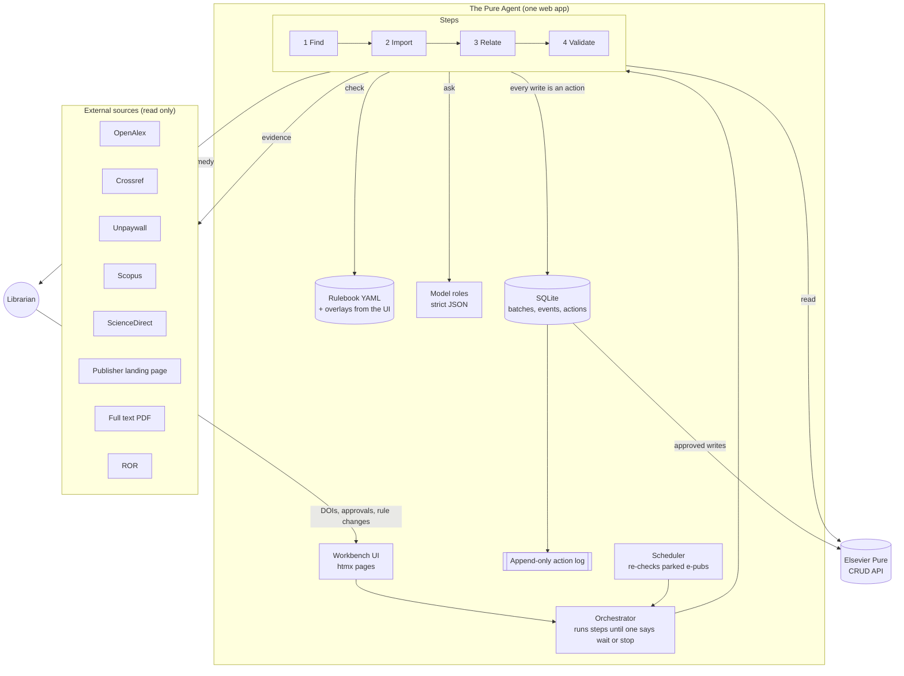

# The Pure Agent: architecture and stack

How Aalborg University Library built an AI agent that may write to Elsevier Pure, and
what holds it back. This document is for other Pure customers who want to build something
similar. It describes the design, the stack and what we learned. It is not a code
walkthrough.

The agent itself is tied to our tenant, our validation guidelines and our staging
instance, so the code is not published. The design is, and you are welcome to copy it.

Presented at EIC2026 (November 2026). Questions: VBN team, Aalborg University Library.

---

## Contents

1. [The task](#1-the-task)
2. [The one design rule](#2-the-one-design-rule)
3. [The architecture at a glance](#3-the-architecture-at-a-glance)
4. [The stack](#4-the-stack)
5. [The rulebook](#5-the-rulebook)
6. [Four model roles](#6-four-model-roles)
7. [Guardrails on writing](#7-guardrails-on-writing)
8. [Data model and audit trail](#8-data-model-and-audit-trail)
9. [The interface](#9-the-interface)
10. [What we learned](#10-what-we-learned)
11. [Pure API notes](#11-pure-api-notes)
12. [If you build your own](#12-if-you-build-your-own)

---

## 1. The task

A librarian pastes a list of DOIs. The agent follows each publication end to end through
four steps:

| Step | Question it answers | What it may write in Pure |
|---|---|---|
| 1 Find | Is it already in Pure? | nothing |
| 2 Import | What should the record say? | the research output; an event when a conference is new |
| 3 Relate | What belongs to it? | relations to projects, datasets, activities, press/media |
| 4 Validate | Is it right? | the fixes it is allowed to make, then the workflow step |

Before the agent we had three separate apps for steps 1 to 3: a finder built on
OpenAlex, an importer, and a project relator. The agent is not a fourth app. It is the
chain, with a fourth step added. That fourth step is the one that needs a written
standard, because it is the one that sets a record to *validated*.

## 2. The one design rule

> **Deterministic rules decide. The model proposes and explains. A human gets what stops.**

In the validate step this is a short piece of code that runs after the rules and the
model have both answered:

```
if any hard rule failed                      -> escalate (the model is not even asked)
if soft findings > limit                     -> escalate
if no model verdict                          -> escalate
if model says escalate                       -> escalate
if model confidence < threshold              -> escalate
if model approves but lists a blocking issue -> escalate
else                                         -> set the workflow step to validated
```

The model can lower the outcome but never raise it. Every place the model is consulted
works the same way:

1. Code gathers the evidence.
2. The model reads it and answers in strict JSON.
3. Code checks the answer against the evidence before it counts.

## 3. The architecture at a glance



Each publication is a **candidate** that moves through the steps. The orchestrator calls
one step at a time. A step can say:

- *continue*: go to the next step,
- *wait*: a write is proposed and a human must approve it (supervised mode),
- *stop*: hand it over to a human, with the rule or reason and what to do about it,
- *park*: it is an e-pub ahead of print, so check it again later.

A candidate is always in one of these states: `queued`, `running`, `waiting`,
`escalated`, `watching` (parked), `done`, `failed` or `rejected`.

### Where the evidence comes from

| Source | Used for |
|---|---|
| Pure | duplicates, other versions of the same work, persons, units, external organisations, journals, events, projects, datasets, activities, press |
| Crossref | the publication's metadata, event data for conferences, a journal's issue pattern |
| OpenAlex | metadata, authorships and institutions, type codes |
| Scopus / ScienceDirect | affiliations as printed, the document type |
| Publisher landing page | affiliations from meta tags when the APIs have none |
| Full text (PDF front matter) | opened only when the sources disagree or are silent |
| Unpaywall | open access status and the location of a legal copy |
| ROR | recognising organisations, including our own hospitals |

For affiliations, the order we trust them in is: Scopus, then the publisher's page, then
Crossref, then OpenAlex, then the PDF.

## 4. The stack

We chose the most boring stack that would work. One process, one database file, and no
build step for the frontend.

| Layer | Choice | Why |
|---|---|---|
| Language | Python 3.12 | what the team already writes; good HTTP and PDF libraries |
| Web framework | FastAPI | async, so it can call many sources at the same time; typed request handling |
| Server | Uvicorn workers under Gunicorn | standard for FastAPI |
| Frontend | Jinja2 templates + [htmx](https://htmx.org) + one CSS file | server-rendered pages with live updates and no JavaScript build |
| HTTP client | httpx (async) | one client for Pure and all sources, with per-source rate limits |
| Database | SQLite through SQLModel (SQLAlchemy + Pydantic) | one file, no server to run; enough for a team-sized tool |
| Settings | pydantic-settings, `.env` file | every key, limit and mode in one place |
| Rulebook | YAML (PyYAML) plus overlays stored in the database | the standard is data the team can read and change |
| Name matching | RapidFuzz | fuzzy matching of person, organisation and journal names |
| PDF | pypdf | reads the front matter for affiliations |
| Scheduler | APScheduler, in process | a nightly re-check of parked e-pub articles |
| LLM | Azure OpenAI (v1 API) through the `openai` SDK, a small reasoning model (`gpt-5-mini`) with low reasoning effort | the university requires its own Azure tenant; strict JSON schema output |
| CLI | Typer + Rich | run batches and checks from a terminal |
| Tests | pytest, pytest-asyncio, respx (mocks HTTP) | every client and rule tested without touching real APIs |
| Lint | Ruff | |
| Hosting | Azure App Service, one worker | SQLite and the in-process scheduler need exactly one worker |

**Single worker on purpose.** SQLite and an in-process scheduler are simple until there
are two processes. A team of librarians running batches of 25 to 50 publications does
not need more, and one worker removes a whole class of concurrency bugs. If you need
scale, move to PostgreSQL and a separate job runner first.

**The LLM is swappable.** The model sits behind a small client with one method per role
and a stub for tests. Nothing in the design depends on a specific provider; what matters
is that it supports a strict JSON schema in the response.

### Configuration

Everything that changes behaviour is a setting, not code:

```ini
# Pure: the test instance by default, production is an explicit opt-in
PURE_BASE_URL=https://<your-pure>/ws/api
PURE_API_KEY=
PURE_RATE_PER_SEC=3
PURE_APPROVED_STEP=validated                 # the step the agent writes when validation passes
PURE_PENDING_STEPS=forApproval,forRevalidation,approved
PURE_NOTE_USERNAME=<Your>_Metadata_Bot       # the name on the notes the agent leaves

# Your institution
INSTITUTION_ROR=https://ror.org/<id>
INSTITUTION_NAME=<Your University>

# Sources
OPENALEX_API_KEY=                            # required by OpenAlex since February 2026
UNPAYWALL_EMAIL=
CROSSREF_MAILTO=
SCOPUS_API_KEY=
SCOPUS_INST_TOKEN=

# Model
LLM_PROVIDER=azure                           # azure | stub
AZURE_OPENAI_ENDPOINT=https://<resource>.openai.azure.com
AZURE_OPENAI_DEPLOYMENT=gpt-5-mini
AZURE_OPENAI_REASONING_EFFORT=low

# Guardrails
AGENT_MODE=supervised                        # dry_run | supervised | live
MAX_WRITES_PER_BATCH=20
MAX_CANDIDATES_PER_BATCH=25
ABORT_AFTER_CONSECUTIVE_FAILURES=3
WATCH_INTERVAL_DAYS=7                        # re-check parked e-pubs
WATCH_MAX_MONTHS=18                          # then hand over to a human
```

A second file, `pure_mapping.yaml`, maps source type codes (Crossref, OpenAlex, Scopus)
to the Pure types of our tenant. That is the part most tied to one institution.

## 5. The rulebook

The quality standard is a YAML file, not a prompt. Ours has 70 rules translated from the
library's written validation guidelines, and every rule cites the guideline it
implements.

Each rule has these fields:

| Field | Meaning |
|---|---|
| `id` | stable, e.g. `TYP-06` |
| `name` | one line |
| `severity` | `hard` (a veto), `soft` (a finding the model weighs), `info` (shown, never counted), `llm` (no check in code; the text is handed to the model) |
| `field` | which part of the record: title, type, authors, affiliation, journal, year, oa, identifiers, … |
| `check` | the name of a deterministic check in code, with `params` |
| `applies_to` | the Pure templates the rule is limited to (empty means all) |
| `description` | the guideline reference and the reasoning |
| `remedy` | what a human does when it fails; shown on the hand-over |

### Example file

This is the layout with four example rules, not our full rulebook:

```yaml
version: "1.0-example"

# Conditions the record the agent has BUILT must meet before it is created in Pure.
import_gate:
  require_journal_for: [ContributionToJournal]
  require_all_institution_authors_resolved: true   # every institutional author is an internal person
  require_contributor_organisation: true           # every person carries an organisation
  require_internal_unit: true                      # a record with no internal unit gets no workflow in Pure
  allowed_types: [ContributionToJournal, WorkingPaper, ContributionToBookAnthology]
  min_year: 1900
  blocking_warning_patterns:                       # warnings from the import that stop it
    - "matches several persons"
    - "not found in Pure"
    - "no type mapping"

# Hard failures always escalate; the model can only lower the outcome.
decision:
  approve_min_confidence: 0.75
  max_soft_failures: 3

# Plain-language guidance handed to the model with every verdict (llm rules are appended).
llm_guidance: >
  Judge the record as a careful librarian following the institution's validation
  guidelines would. Approve only records you would not edit before validating.

rules:
  # A deterministic hard rule with parameters.
  - id: ID-02
    name: DOI resolves in Crossref or OpenAlex
    severity: hard
    field: identifiers
    check: doi_resolves
    params: {require: any}
    description: "Guideline 3: a DOI that resolves nowhere is a typo or not yet registered."
    remedy: "Check the DOI on doi.org; if it is wrong, correct it; if it is new, wait for Crossref."

  # A hard rule that reads the content, limited to one template.
  - id: TYP-06
    name: Type fits the content (book review, editorial, letter, comment, erratum)
    severity: hard
    field: type
    check: type_fits_content
    applies_to: [ContributionToJournal]
    description: "Guideline 5: a book review, editorial, letter, comment or erratum is not a journal article."
    remedy: "Change the type to the one the content calls for, and set peer reviewed to no."

  # A soft rule: reported and weighed by the model, never a veto on its own.
  - id: AFF-05
    name: Internal authors carry their external affiliations from the publication
    severity: soft
    field: affiliation
    check: missing_external_affiliations
    description: "Guideline 37: an internal author who also signs with a hospital or another university carries that organisation on the record."
    remedy: "Add the external organisation from the publication on the internal contributor."

  # A model rule: no check in code; the text is the rule.
  - id: LLM-02
    name: Letters, editorials, comments and errata are not articles
    severity: llm
    field: type
    description: "If the Crossref type is editorial or letter, or the title starts with 'Comment on', 'Reply to', 'Erratum' or 'Corrigendum', the record is not a research article: escalate with the evidence."
    remedy: "Retype the record; set peer reviewed to no."
```

### Three things that made the rulebook work

1. **Overlays, not edits.** The base file is versioned with the code. Whatever the team
   changes in the interface (severity, on/off, parameters, new rules, exceptions, extra
   guidance to the model) is stored as an overlay in the database and applied on the next
   run. A new rule needs no release.
2. **Three kinds of additions.** A *deterministic rule* picks a check from a catalogue and
   sets its parameters. A *model rule* is written in plain language, as you would explain
   it to a new colleague. An *exception* skips a rule for one DOI, journal, type, unit or
   person, and it is shown in every assessment it affects, so nothing is skipped silently.
3. **The rulebook version is written into Pure.** Every note the agent leaves on a record
   names the rulebook version the record was checked against.

## 6. Four model roles

The same model is used every time, in the same shape: a fixed system prompt, a strict
JSON schema and low reasoning effort. A first run costs about 5,700 tokens per
publication.

| Role | When | What it gets | What limits its answer |
|---|---|---|---|
| Type judge | import, every publication | title, abstract, venue, pages, the sources' type codes, the type the mapping proposes, the full list of types this Pure offers | used only within the same template, when it is confident, and when a content check in code does not contradict it |
| Person judge | import, when the name alone does not settle it | the author as printed (affiliation, ORCID) and a dossier per candidate built by code: employment periods, units, recent outputs, shared co-authors | used only when the computed signals point the same way; otherwise a human picks |
| Relation judge | relate | the authors' other datasets, activities and press items from around the publication date, with abstracts | direct DOI or title hits are linked; matches on context alone are suggested, or linked only if a setting allows it |
| Validator | validate, after the rules | the evidence bundle, every rule result (failed, passed, skipped), the rulebook's `llm` rules and the team's guidance | cannot overrule a failed hard rule; see the decision rule in section 2 |

### The validator's prompt

This is the system prompt, word for word:

> You are a metadata validator for a university library's research information system
> (Elsevier Pure). You review ONE research output record against the evidence gathered
> for it: the Pure record itself (with possible duplicates and other versions in Pure),
> OpenAlex, Crossref, Unpaywall, Scopus, ScienceDirect, the publisher's landing page, the
> front matter of the full text when it was opened, the journal's issue pattern, and ROR
> for affiliations; and against the results of the deterministic rule checks that have
> already been run.
>
> Your task: decide whether the record can be set to validated as it is, or must be
> escalated to a human.
>
> Principles:
> - Be concrete. Every issue must point at evidence. Never invent facts that are not in the evidence.
> - Deterministic rule results are authoritative. If a hard rule failed, your verdict must be "escalate".
> - "approve" means: a careful librarian would validate this record without editing it. Minor cosmetic differences (capitalisation, punctuation, diacritics, abbreviated journal names) are not issues.
> - Escalate when sources disagree on substance (title, authorship, venue, year, type), when an institutional author appears unmatched, when the DOI may already exist in Pure, or when the record looks like a preprint, retraction, correction or paratext.
> - Confidence expresses how sure you are of the verdict, not how good the record is.
> - Write the summary in English, plainly, for a reviewer who has ten seconds.

The answer schema (strict, no extra properties allowed):

```json
{
  "verdict": "approve | escalate",
  "confidence": 0.0,
  "summary": "two to four sentences",
  "issues": [
    {
      "field": "title | authors | journal | oa | identifiers | type | year | other",
      "severity": "blocking | minor",
      "explanation": "concrete, cites the evidence",
      "suggested_fix": "what a human should change, or null"
    }
  ]
}
```

There is nothing clever in the prompt. The work is in what the model gets.

## 7. Guardrails on writing

- **Three modes.** *Dry run* writes nothing and shows what it would have written.
  *Supervised* stops before every write for a human to approve it. *Live* writes the
  clear cases and hands the rest over.
- **How far the chain runs** is a setting: look up only, create, create and relate, or
  the whole chain. Whatever the agent leaves undone stays for a human in Pure.
- **Budgets.** There is a limit on publications per batch and on writes per batch. At the
  limit the batch pauses and waits for a human to resume it.
- **A circuit breaker.** After a few failed writes in a row, the run stops.
- **Every write is an action row** with the step, kind, mode, status (`would_write`,
  `proposed`, `written`, `failed`, `rejected`, `reverted`), who decided, the request and a
  before-image. Undo is an ordinary API call built from the before-image, and it leaves
  its own note.
- **Every write leaves a note on the Pure record** with the reason, the rulebook version
  and, for model decisions, the model's own sentence and confidence. A colleague who
  opens the record a year later needs nothing but Pure to see what happened.
- **An append-only file log** sits beside the database, so the trail survives the
  database.
- **Refusals in code**, independent of the model:
  - never create a record when Pure already holds the DOI (checked once more just before
    creating),
  - never attach an external organisation that is not approved in Pure,
  - never create a record that would carry no internal unit,
  - never touch a record that is already validated.
- **Parked, not failed.** An article that is only online ahead of print is parked and
  checked again on a schedule until the volume and issue are out. Journals that never
  number issues are validated on the volume alone; the agent finds out by reading the
  journal's own recent articles in Crossref.
- **Test instance by default.** The agent points at the Pure staging instance unless
  production is chosen explicitly.

## 8. Data model and audit trail

Ten small tables. The names say what they hold:

| Table | Holds |
|---|---|
| `Batch` | one run: label, mode, when it started |
| `Candidate` | one publication: DOI, current step, state, reason, Pure UUID once created |
| `StepEvent` | the timeline: every check, decision, proposal, write, model call, human action and error, in order |
| `Assessment` | each validation: the rule results, the model verdict, the final decision |
| `Action` | each write, proposed or done, with request and before-image |
| `RuleOverride` | changes to a base rule from the UI |
| `CustomRule` | rules the team added in the UI |
| `RuleException` | a rule skipped for one DOI, journal, type, unit or person |
| `PersonChoice` | a human's choice of which Pure person an author is (or that they are external) |
| `Setting` | settings changed in the UI (chain length, model roles on/off) |

The timeline (`StepEvent`) is what the interface shows, and it is also what makes the
agent explainable: you can read why it did what it did without opening a log.

## 9. The interface

A small web app with these pages:

- **Workbench**: paste DOIs, choose the mode, start a batch, see every publication as a
  line with its state.
- **Publication**: the timeline of one publication, step by step, with the evidence, the
  rule results, the model's answer, and any write waiting for approval (approve / reject).
- **Hand-over**: what stopped, which rule, and the remedy in plain words.
- **Batch report**: a funnel of how far publications got, the reasons they stopped
  (split by rulebook, agent and model), writes counted, time per publication, CSV
  export.
- **Rulebook**: every rule, with on/off, severity, parameters, custom rules, exceptions
  and guidance to the model.
- **Settings**: how far the chain runs, and which model roles are on.

Pages update live through htmx while a batch runs.

## 10. What we learned

- **Write the standard down before you give anything write access.** The rulebook was
  the first thing we built and is the last thing we would give up.
- **A green run is not a clean record.** One of the first smooth runs created, uploaded
  and validated a book review as a peer-reviewed journal article in the wrong language.
  Every rule that existed passed. The fix was three rules and a model role (the type
  judge), not a better prompt. Read the record, not the status.
- **The biggest stop is not the model.** On a batch of fifty known-good publications, the
  largest group of hand-overs was publishers that will not give a script the PDF. Next
  came persons and organisations not yet in Pure. The model asked for a human once.
- **Names need care.** Transliterate national letters (æ, ø, å, ü …) before matching,
  require the given name to fit, and compute the namesake evidence (employment on the
  date, units, co-authors) in code before asking anyone, human or model, to choose.
- **"Ours" is more than one ROR.** Our university hospitals count as our own
  organisations. Decide early which organisations are internal, by ROR and by name.
- **Test data is the hard part.** A staging Pure that mirrors production already holds
  almost everything, so end-to-end tests mean finding publications it does not hold,
  without deleting or editing real records. Expect small batches.
- **Keep the model small and the token count low.** A small reasoning model with low
  effort is enough when code has done the gathering. The expensive part of every run is
  waiting for external APIs, not the model.

## 11. Pure API notes

Things that cost us time, for anyone writing against the Pure CRUD API:

- Research output search ignores the `workflowSteps` filter on our tenant; filter on the
  client side.
- Workflow: `PUT /research-outputs/{uuid}/workflow` with the step. Our final step is
  `validated`; `approved` is an older decentral step that counts as pending. Check your
  own tenant's steps.
- A dataset relation on a research output is
  `{"dataSet": {"systemName": "DataSet", "uuid": "…"}}`, not a plain reference like
  activities.
- Press/media relates from its own side (`/pressmedia`), not from the output.
- Records without any internal organisation get no workflow at all; check before
  creating.
- `GET /persons/{uuid}/dependents` gives a person's outputs cheaply; use it to compute
  co-author and recency signals for namesakes.
- `GET /research-outputs/allowed-types` is the list the type judge chooses from (ours has
  44 types).
- Events: call `GET /events/allowed-types` and `/events/allowed-countries` before creating
  one from Crossref's event data, and match an existing event on start date and name
  first.
- The submission year in Pure is the reporting year, not necessarily the publication
  year.
- Keep every write's before-image. The API gives you the full object; store it with the
  request.

## 12. If you build your own

A suggested order, from what we would do again:

1. **Write your rulebook first.** Translate your team's validation guidelines into rules
   with an id, a severity and a remedy. Start with the hard rules. Use the example in
   section 5 as a template.
2. **Build the validate step in dry run only.** Run it on records already in Pure and
   compare its verdicts with what your team decided. This needs no write access at all.
3. **Add the model last, as a reviewer.** Give it the evidence and the rule results, ask
   for strict JSON, and let code decide. Measure how often it disagrees with the rules
   before you rely on it.
4. **Turn on writes in supervised mode**, on the staging instance, with small budgets.
   Read every record it creates against the publication.
5. **Log every write with a before-image and a note in Pure** from day one. You will need
   undo sooner than you expect.
6. **Go live only for the narrow slice that is always clean**, and let everything else
   be handed over with a clear remedy.

### What is not here

The code, our full rulebook (it is our guidelines, not a standard), tenant
configuration, API keys and any record data. If you build your own, start from the
rulebook format and the decision rule above; the rest follows from them.
